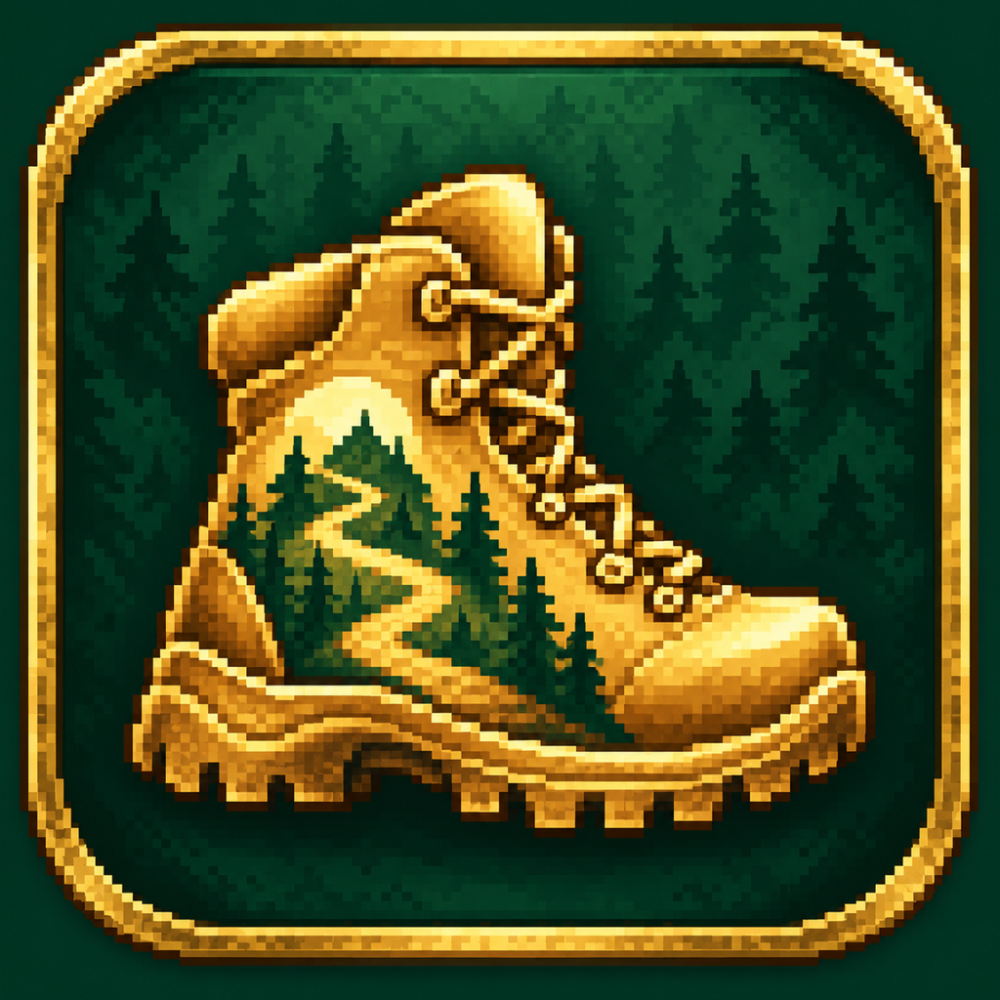
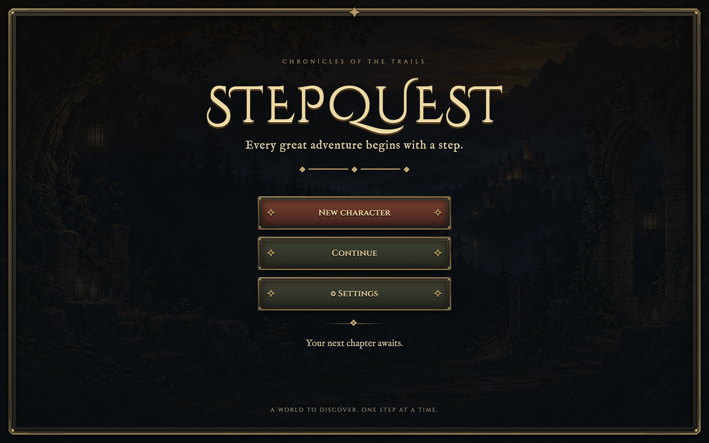
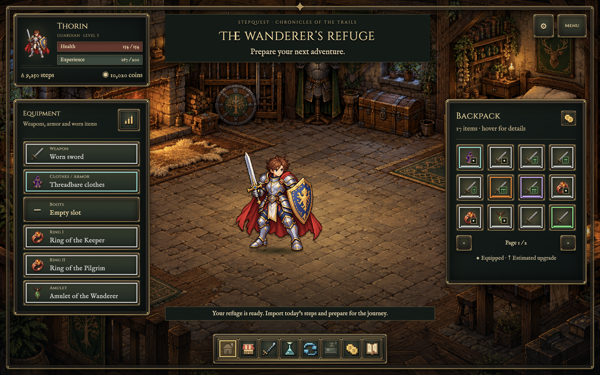
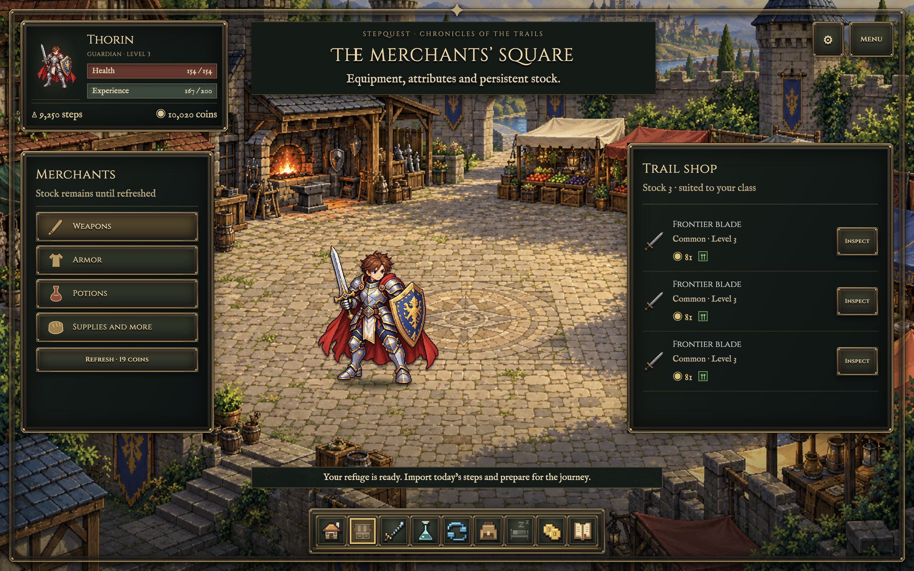

<p align="center">
  
</p>

# StepQuest

**Your steps. Your hero. Your adventure.**

StepQuest is a pixel-art fantasy RPG that turns your daily Garmin steps into adventures. Battle monsters, collect loot, explore branching expeditions, and grow your hero through the steps you take in the real world.

[Download the latest release](https://github.com/Gladiak/StepQuest/releases/latest) · [Changelog](CHANGELOG.md) · [Game rules](docs/game-loop.md) · [Report an issue](https://github.com/Gladiak/StepQuest/issues)



## Walk, explore, grow

Import today's steps from your Garmin account and spend them on battles, expeditions, or coins for supplies and equipment. Each hero has an independent daily step balance: the same Garmin day can be credited to every character. Opening a hero automatically credits today's already synchronized steps; later imports add only that hero's new steps. The Continue cards show each hero's level and depth.

- **Six hero classes:** Guardian, Arcanist, Ranger, Rogue, Druid, and Berserker, with twelve original character sprites and three local save slots.
- **Turn-based battles:** choose your actions or use automatic combat, challenge elite enemies, and collect experience, coins, and equipment.
- **Equipment refinement and targeted searches:** invest steps in five permanent refinement ranks or a four-stage search offering a choice of two equipment rewards.
- **Branching expeditions:** choose a route, face story events, manage supplies, and decide whether to return with your loot or face the final guardian.
- **Loot and equipment:** discover six rarities, compare upgrades, complete class sets, and hunt rare endgame collections.
- **Market and alchemy:** buy and sell gear, exchange steps for coins, and permanently enchant individual items with rare reagents.
- **Automatic mine:** send a crew on timed expeditions, collect ore and fantasy gems offline, unlock deeper floors, and upgrade mining tools.
- **Blacksmith:** craft equipment with ore and coins, level the profession for better rarity chances, reforge attributes while preserving upgrades, and refine gear with steps.
- **PvE arena:** practise with separate health, earn three free daily XP rewards, and unlock three additional challenges with coins or steps.
- **Daily Garmin effects:** supported activity, sleep, and stress data can affect the day's adventure; unavailable data stays neutral.
- **Explorers’ Guild and Wanderer’s Atlas:** six movement-based story chapters, permanent choices on a pixel-art province map, two encounters and the Lantern Beacon expedition with its own Warden. Existing Guild progress carries over.
- **Refuge Chronicles:** 21 illustrated keepsakes for walking, recorded activities, exploration and professions; a five-stop Lantern Circuit; two cosmetic titles; and three personal banner seals. Every keepsake has a story, with permanent dates and a choice-specific Oak emblem.
- **A book of memories:** open the Chronicles from the Guild board or your profile, track milestones and equip three keepsake seals. The Guild navigation keeps Board and Atlas side by side.
- **Six interface languages:** English, Italian, French, Spanish, German, and Japanese.
- **Local saves:** characters, inventory, progress, and imported steps are stored in SQLite on your computer, with verified backups before migrations and recovery on startup failure.

| Home and equipment | Market |
| --- | --- |
|  |  |

## Download and play

Download **v1.2.0** from the [Releases page](https://github.com/Gladiak/StepQuest/releases/tag/v1.2.0). See the [release notes](docs/release-notes-v1.2.0.md) for the Guild, Atlas, Chronicles and save compatibility details. Each release includes a `SHA256SUMS.txt` file for verifying the downloads.

| Platform | Download |
| --- | --- |
| macOS — Apple Silicon | `StepQuest-1.2.0-mac-arm64.zip` |
| macOS — Intel | `StepQuest-1.2.0-mac-x64.zip` |
| Windows — x64 portable | `StepQuest-1.2.0-windows-x64-portable.exe` |
| Linux — x64 AppImage | `StepQuest-1.2.0-linux-x86_64.AppImage` |
| Debian / Ubuntu — x64 | `StepQuest-1.2.0-linux-amd64.deb` |
| Fedora / RPM distributions — x64 | `StepQuest-1.2.0-linux-x86_64.rpm` |

On macOS, extract the ZIP and move **StepQuest.app** to Applications. On Windows, run the portable executable. On Linux, install the DEB/RPM package or make the AppImage executable with `chmod +x StepQuest-1.2.0-linux-x86_64.AppImage` and run it. AppImage may require your distribution's FUSE compatibility package.

The macOS package is ad-hoc signed and not notarized; Windows signing is not configured. Your operating system may display a security warning or require explicit approval before opening the app.

Create a hero, open **Settings**, and enter your own Garmin Connect Personal API key to import today's steps. A valid Personal API key and internet access are required for Garmin synchronization. Character creation and access to existing local saves work offline.

## Your data

StepQuest connects directly to the Garmin Connect Personal API. It does not require a StepQuest backend or account.

Your Garmin key is stored **in plain text in the local SQLite database**, with access restricted to the current user where supported. Database backups therefore also contain the key. Temporary access tokens stay in memory. The repository and release packages exclude `.env` files, personal databases, profiles, and exports.

StepQuest is an independent project and is not affiliated with or endorsed by Garmin.

## Run from source

Requires **Node.js 22.12 or later** and npm.

```bash
git clone git@github.com:Gladiak/StepQuest.git
cd StepQuest
npm ci
npm start
```

Enter your key in the app's Settings. For development, you can also copy `.env.example` to `.env` and set `GARMIN_API_KEY`. Keep that file private; Git ignores it.

```bash
npm test                   # Offline unit and integration tests
npm run test:electron      # UI checks using an isolated temporary profile
npm run test:release       # Deterministic economy and large-inventory audit
npm run pack               # Unpacked app for the current platform
npm run dist:mac           # macOS ZIP for the current architecture
npm run dist:win           # Windows x64 portable executable
npm run dist:linux         # Linux x64 AppImage, DEB, and RPM
```

Run each distribution command on its matching operating system. The [release workflow](.github/workflows/release.yml) builds both macOS architectures plus Windows and Linux on native GitHub runners. It tests the project, checks packaged files for private data, exercises the installed application on every platform, and publishes all six downloads with SHA-256 checksums only after every build succeeds.

`npm run check:garmin` is an optional live connection check: it requires your key and makes real Garmin API requests.

## Built with

Electron, JavaScript, HTML/CSS, and SQLite (`node:sqlite`), with bundled pixel-art assets and fonts. The renderer uses context isolation, sandboxing, and an explicit IPC bridge for game actions and Garmin access.

See the [game rules](docs/game-loop.md), [loot catalog](docs/loot-library.json), and [development notes in Italian](docs/development-it.md) for implementation and balancing details.

## License

[MIT](LICENSE). Bundled fonts retain their [SIL Open Font Licenses](renderer/assets/fonts/README.md).
